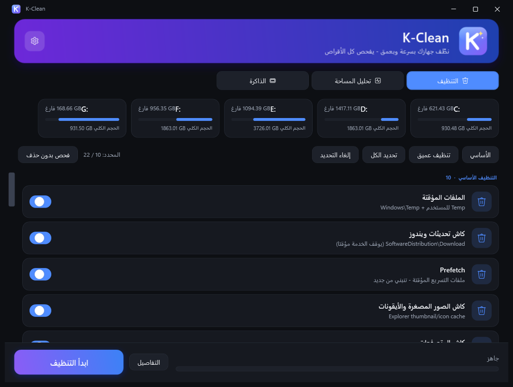
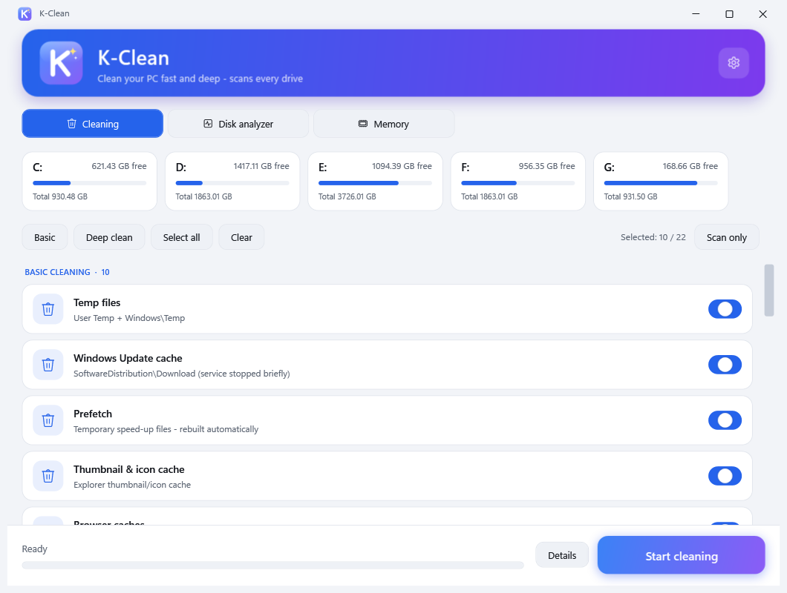
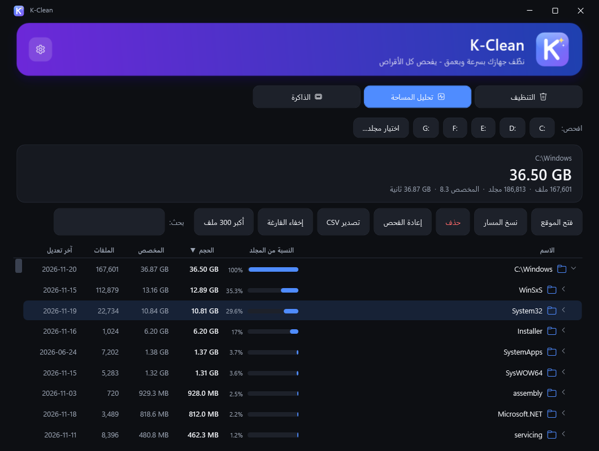
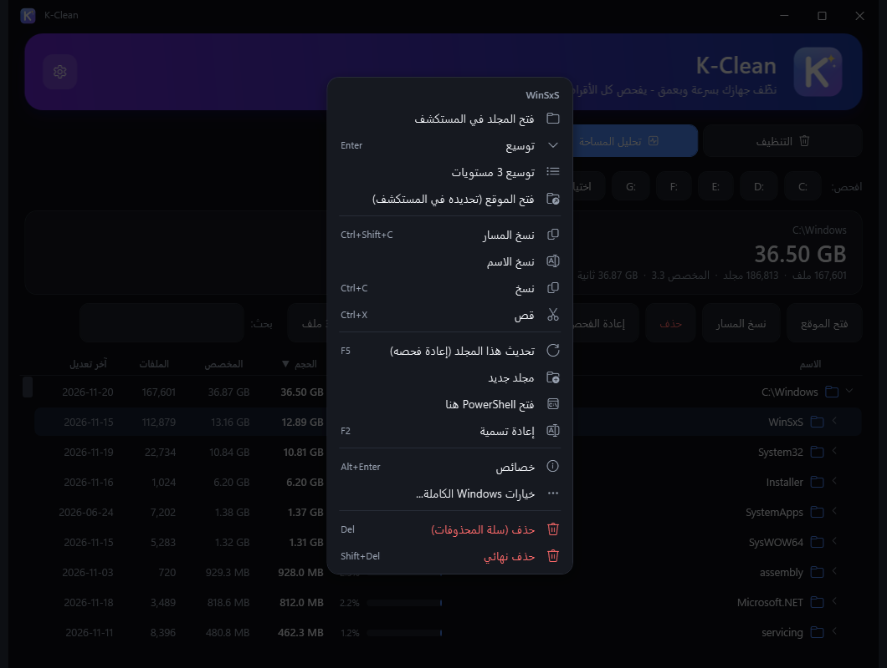
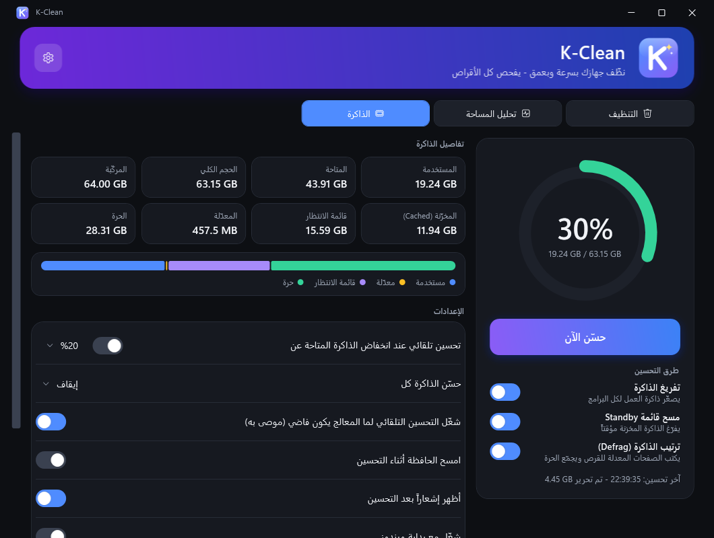
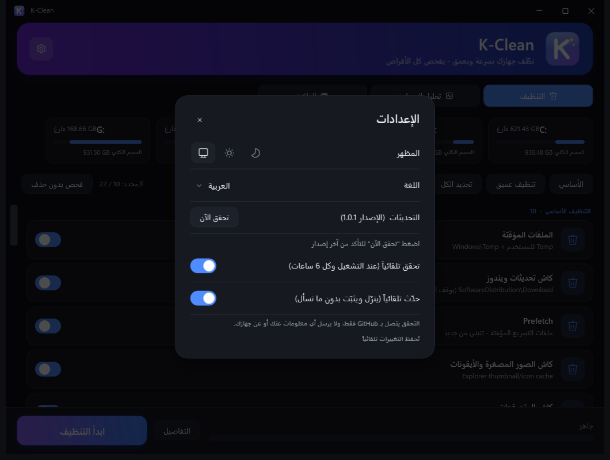

<div align="center">

# K-Clean

**أداة ويندوز ثلاثية في برنامج واحد: تنظيف عميق، تحليل مساحة الأقراص، وتحسين الذاكرة**
**Three Windows tools in one app: deep cleaner, disk space analyzer and RAM optimizer**

واجهة حديثة داكنة وفاتحة · عربي وإنجليزي · يفحص كل الأقراص · يتحدث تلقائياً
Modern dark / light UI · Arabic and English · scans every drive · updates itself

### [⬇ Download the latest version / حمّل آخر إصدار](../../releases/latest)



</div>

---

## نبذة عن البرنامج

**K-Clean** يساعدك ترجّع مساحة قرصك وتسرّع جهازك بدون ما تحتاج عدة برامج. فيه ثلاث صفحات:

1. **التنظيف**: تختار اللي تبي تنظفه (ملفات مؤقتة، كاش المتصفحات، كاش كرت الشاشة، تقارير الأعطال، سلة المحذوفات، كاش Steam وغيرها)، أو تسوي **تنظيف عميق**. يبحث في **كل الأقراص** مو بس C:.
2. **تحليل المساحة**: يوريك أي مجلد وأي ملف ياخذ مساحة قرصك، بسرعة (قرص النظام بحدود 7 ثواني)، وتقدر تفتح المجلد وتحذف مباشرة من البرنامج.
3. **الذاكرة**: تحسين الرام بضغطة وحدة، مع تحسين تلقائي ومراقبة حية.

## About

**K-Clean** gives you back disk space and speeds up your PC without juggling several tools. It has three pages: a **Cleaner** (basic and deep cleaning across every drive), a fast **Disk analyzer** (see what is eating your space, then act on it right there) and a **Memory** optimizer (one-click RAM optimization, auto mode and live monitoring).

---

## Screenshots / لقطات الشاشة

| | |
|---|---|
| <br>**التنظيف** · Cleaning | <br>**الثيم الفاتح والإنجليزي** · Light theme, English |
| <br>**تحليل المساحة** · Disk analyzer | <br>**قائمة الكليك اليمين** · Right-click menu |
| <br>**الذاكرة** · Memory optimizer | <br>**الإعدادات والتحديثات** · Settings and updates |

---

## المميزات / Features

### التنظيف / Cleaning
- **تنظيف أساسي**: ملفات Temp، كاش Windows Update، Prefetch، كاش الصور المصغرة، كاش المتصفحات (Chrome / Edge / Brave / Firefox بدون ما يمس كلمات السر أو التاريخ)، كاش الشيدرز، كاش البرامج، تقارير الأعطال، سلة المحذوفات، وكاش Steam على كل الأقراص.
- **تنظيف عميق**: Disk Cleanup الكامل، تنظيف مخزن مكونات ويندوز (DISM)، سجلات ويندوز، Delivery Optimization، كاش تطبيقات المتجر، ملفات dump الكبيرة، مخلفات التحديث على كل الأقراص، وفحص شامل للملفات المؤقتة.
- **عمليات حساسة** (تطلع لها رسالة تأكيد): مسح سجلات الأحداث، حذف نقاط الاستعادة، كاش المطورين.
- **فحص بدون حذف** يوريك كم ممكن يتحرر قبل ما تحذف شي، وزر **إيقاف** أثناء التنظيف.
- Basic and deep cleaning, advanced options with a confirmation prompt, a scan-only mode and a Stop button.

### تحليل المساحة / Disk analyzer
- فحص أي قرص أو مجلد بسرعة، وشجرة مجلدات مرتبة بالحجم مع شريط نسبة من المجلد الأب.
- أعمدة: الحجم، الحجم المخصص (Allocated)، عدد الملفات، آخر تعديل، وترتيب بالضغط على أي عمود.
- **كليك يمين**: فتح، فتح الموقع في المستكشف، نسخ المسار والاسم، نسخ وقص، إعادة تسمية، مجلد جديد، تحديث المجلد، فتح PowerShell هنا، خصائص، **قائمة ويندوز الكاملة** (Open with، Send to...)، وحذف (لسلة المحذوفات أو نهائي).
- اختيار متعدد، بحث، أكبر 300 ملف، إخفاء المجلدات الفارغة، وتصدير إلى CSV.
- Fast scan, size-sorted tree, full right-click menu including the real Windows context menu, multi-select, search, largest files and CSV export.

### الذاكرة / Memory
- عداد دائري حي مع تفاصيل: مستخدمة، متاحة، Cached، Standby، Modified، حرة.
- **حسّن الآن** بثلاث طرق: تفريغ الذاكرة، مسح قائمة Standby، وDefrag.
- **تحسين تلقائي**: عند انخفاض الذاكرة، أو كل فترة، وبس لما المعالج فاضي.
- أيقونة في شريط المهام تعرض نسبة الاستخدام، إشعار بعد التحسين، اختصار لوحة مفاتيح، وتشغيل مع ويندوز.
- One-click optimize, auto optimize (low memory / interval / CPU idle), live tray icon, hotkey and run at startup.

---

## التحديث التلقائي / Automatic updates

**K-Clean يحدّث نفسه.** عند تشغيله وكل 6 ساعات يتحقق من آخر إصدار هنا في GitHub. إذا نزل تحديث جديد:
1. يطلع لك **إشعار** بالإصدار الجديد.
2. بعد عدّاد 15 ثانية يحمّل التحديث، ويتأكد من بصمته (**SHA-256**)، ويثبّته فوق النسخة الحالية، ويعيد التشغيل. إعداداتك واختصاراتك تبقى. تقدر تضغط **لاحقاً** إذا مشغول.
3. ما يقاطع شغلك: ينتظر لين ينتهي أي تنظيف أو فحص شغّال.

التحقق يتصل بـ GitHub فقط **ولا يرسل أي معلومات عنك أو عن جهازك**. تقدر توقف التحديث التلقائي أو التحقق التلقائي من **الإعدادات ← التحديثات**، وتقدر تضغط **تحقق الآن** في أي وقت.

**K-Clean updates itself.** At startup and every 6 hours it checks the latest release on GitHub. When a new version is out you get a notification, then after a short 15-second countdown it downloads the update, verifies its SHA-256, installs it over the current version and restarts (settings and shortcuts are kept). It never interrupts a running clean or scan, and it sends no information about you or your PC. You can turn automatic updating off in **Settings → Updates**.

---

## التثبيت / Install

1. من صفحة **[Releases](../../releases/latest)** حمّل `K-Clean-Setup.exe`.
2. شغّله، اختر اللغة (عربي / English) ومسار التثبيت (الافتراضي `C:\Program Files (x86)\K-Clean`)، وخيارات الاختصارات.
3. تقدر تحذفه من **الإعدادات ← التطبيقات** في ويندوز.

Download `K-Clean-Setup.exe` from **[Releases](../../releases/latest)**, pick your language and install path, done. Uninstall from *Settings → Apps*.

### التثبيت الصامت / Silent install

```
K-Clean-Setup.exe /S "/D=C:\Program Files (x86)\K-Clean" /LANG=en
K-Clean-Setup.exe /uninstall /S
```

---

## ملاحظات مهمة / Good to know

- **يحتاج صلاحية مدير** (عشان ينظف مجلدات النظام ويحسّن الذاكرة). Needs administrator permission.
- المثبّت **غير موقّع رقمياً**، فممكن يطلع تحذير SmartScreen: اضغط *More info ← Run anyway*. The installer is not code-signed, so SmartScreen may warn: *More info → Run anyway*. تقدر تتأكد من الملف بالبصمة المكتوبة في ملاحظات كل إصدار. You can verify the file with the SHA-256 in each release's notes.
- التنظيف **يحذف ملفات**. راجع الخيارات المحددة قبل ما تضغط "ابدأ التنظيف"، والعمليات الحساسة ما يمكن التراجع عنها. Cleaning deletes files, so review the selected options first.
- حذف الملفات من صفحة تحليل المساحة يروح لسلة المحذوفات افتراضياً. Deleting from the analyzer goes to the Recycle Bin by default.
- ملفات OneDrive اللي على السحابة فقط ما تنحسب لأنها ما تاخذ مساحة فعلية. Cloud-only OneDrive files are not counted as they use no disk space.
- مبني ومجرَّب على Windows 11، ويفترض يشتغل على Windows 10. Built and tested on Windows 11; it should also work on Windows 10.

## الخصوصية / Privacy

البرنامج يشتغل على جهازك فقط. الاتصال الوحيد بالإنترنت هو التحقق من التحديثات (طلب HTTPS عادي لـ GitHub). ما فيه تتبع ولا إعلانات ولا جمع بيانات.
K-Clean runs locally. Its only network request is the update check (a plain HTTPS request to GitHub). No tracking, no ads, no data collection.

## Install from the command line / التثبيت من سطر الأوامر

```
winget install kloody60.K-Clean
scoop bucket add kclean https://github.com/kloody60/scoop-kclean
scoop install k-clean
```

Website / الموقع: https://kloody60.github.io/K-Clean/
